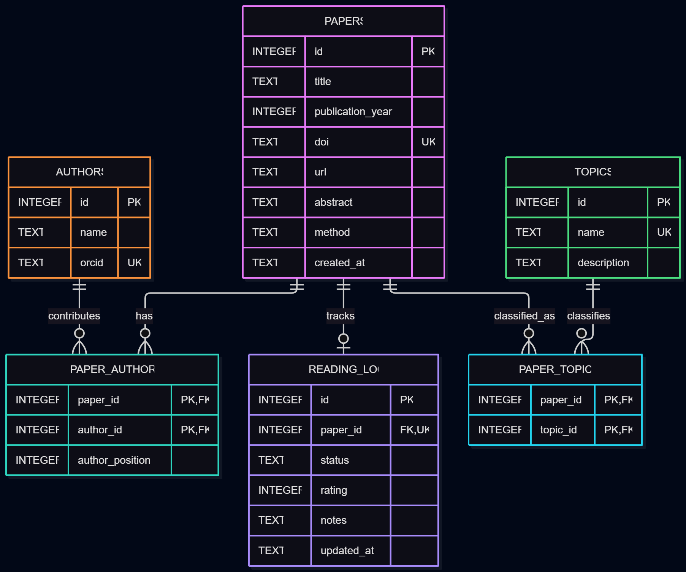

## AI Research Atlas
# Overview
AI Research Atlas is a relational database for organizing, exploring, and reviewing research papers in artificial intelligence, machine learning, and natural language processing (NLP). The project is intended for students and early-career researchers who need a structured way to keep track of relevant papers, their authors, research topics, and personal reading progress.

The database is designed as the data layer of a future research discovery application. It does not implement machine learning algorithms or retrieve papers from the internet by itself. Instead, it provides a reliable structure on which a Python application, an NLP pipeline, or a recommendation system could later be built.

# Scope
The database stores bibliographic information about research papers, author information, topic classifications, and individual reading records.

Its primary tasks are:

Store papers with unique identifiers, titles, publication years, abstracts, DOIs, URLs, and descriptions of their methods.
Associate papers with one or more authors and research topics.
Record whether a paper is unread, in progress, completed, or skipped.
Store personal ratings and notes about papers.
Retrieve papers by topic, year, author, reading status, or method.
Produce summary reports about research topics and reading activity.
The database does not store full PDF documents, execute machine learning experiments, evaluate the scientific validity of a paper, or automatically generate recommendations. Those features are outside the scope of this implementation.

# Entities and Relationships
# Papers
The papers table is the central entity. Each paper has a unique integer ID, a required title, a publication year, an optional abstract, a DOI, a URL, and a description of its principal method.

A DOI is unique when provided. The URL is optional because some papers may be identified by a DOI or bibliographic information alone. The publication year is constrained to a plausible range.

# Authors
The authors table stores each author's name and an optional ORCID identifier. ORCID is unique when present, which helps distinguish researchers who have similar names.

# Paper Authors
A paper can have multiple authors, and an author can contribute to multiple papers. The paper_authors junction table resolves this many-to-many relationship. Its composite primary key prevents the same author from being assigned to the same paper twice. An author position records the author's order in the original publication.

# Topics
The topics table stores unique topic names, such as Machine Learning, Natural Language Processing, Computer Vision, and Reinforcement Learning. A description can explain the scope of each topic.

# Paper Topics
A paper can belong to multiple topics, and a topic can describe many papers. The paper_topics junction table implements this many-to-many relationship and prevents duplicate assignments.

# Reading Log
The reading_log table stores a user's reading status, a rating, personal notes, and the date the record was created or last updated. Each paper can have at most one reading record in this initial, single-user design.

The reading status is restricted to a defined set of values, and ratings must be integers from 1 to 5. A paper's bibliographic information is kept separate from the reader's personal notes to reduce duplication.

## Entity Relationship Diagram

The following diagram illustrates the database tables, their key attributes, and the relationships between them.

## Design Decisions and Optimizations
The schema uses SQLite-compatible data types, primary keys, foreign keys, NOT NULL, UNIQUE, and CHECK constraints to preserve data integrity.

Junction tables are used instead of storing comma-separated author names or topic lists. This makes it possible to query and aggregate relationships accurately and avoids duplicating author or topic information across papers.

Indexes are added to columns used frequently for filtering, including publication year, reading status, author relationships, and topic relationships. These indexes can reduce the work required for common searches, at the cost of additional storage and slightly more work during insertions and updates.

The paper_catalog view joins bibliographic data with reading progress. The topic_statistics view summarizes the number of papers assigned to each topic and the number marked as completed. These views centralize commonly used reporting logic without duplicating stored data.

Foreign-key enforcement is enabled when the SQLite connection is opened. Cascading deletion is used for junction records and reading records so that removing a paper does not leave orphaned relationships. Author and topic records are not automatically deleted when their last paper relationship disappears.

# Limitations and Future Development
The first version is designed for one reader. A future version would introduce a users table and associate reading records with individual users, allowing multiple researchers to maintain separate ratings and notes.

Topic classification is manual, so the database cannot guarantee that papers have been categorized consistently. It also does not validate whether a paper's abstract, method description, or author information is scientifically accurate.

Future improvements could include importing metadata from public scholarly APIs, storing embeddings generated from abstracts, semantic search using vector similarity, automatic topic classification, and a recommendation engine based on reading history and paper similarity.

These extensions would require additional application logic, external data sources, and possibly a specialized search or vector database. The relational database would remain responsible for storing structured metadata and maintaining relationships.

# Conclusion
AI Research Atlas demonstrates relational database design through normalized tables, many-to-many relationships, integrity constraints, indexes, views, and representative data manipulation and analytical queries. Its structure is useful independently and provides a practical foundation for a future AI-assisted research discovery tool.

# Video link
https://youtu.be/-VU1WBBwQRk?feature=shared
